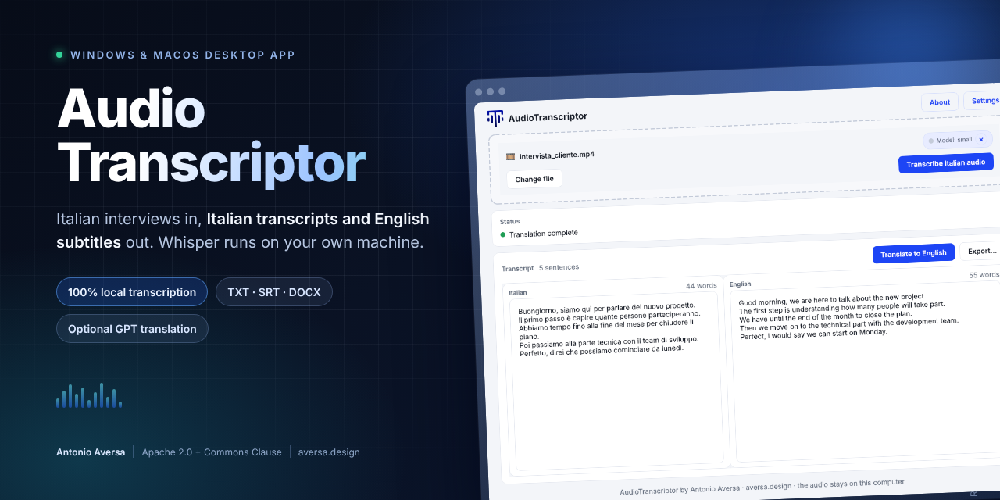
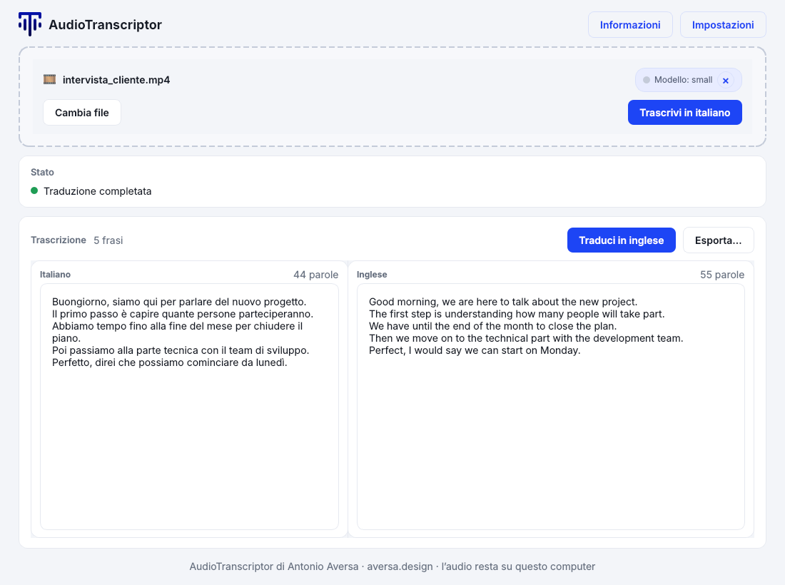
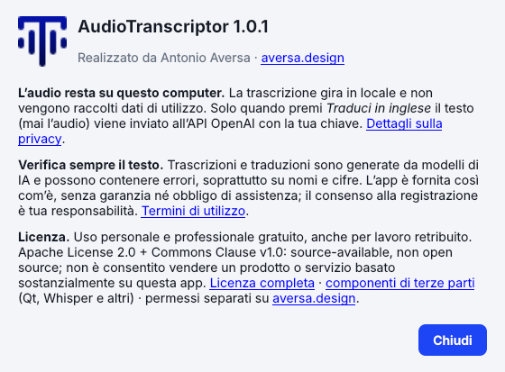

# AudioTranscriptor

<p align="center">
  
</p>

<p align="center">
  <b>Italian interviews in. Italian transcript and English subtitles out. The audio never leaves your computer.</b>
</p>

<p align="center">
  <a href="https://aversa.design"></a>
  <a href="LICENSE"></a>
  
  
  
</p>

AudioTranscriptor is a desktop app for people who record Italian conversations and need them
written down: journalists, researchers, lawyers, podcasters, students. Drop an audio or video
file, get an editable Italian transcript, translate it to English when you need to, and export
TXT, SRT or DOCX.

Whisper runs on your machine. There is no account, no upload of your media, no telemetry, and
the app works offline apart from the two things listed in [Privacy](#privacy).

## Download

Release preparation status: the macOS Apple silicon package has been built and
locally tried. The Windows installer and portable zip are built and self-tested
by the GitHub Actions workflow (packaging, legal files, self-test that runs a
real transcription); the Windows interface itself has not yet been run by hand
on a Windows machine. Use <https://aversa.design> for official download
information; no release has been published yet, so do not assume the files
below are downloadable.

| File | What it is | Use it when |
| --- | --- | --- |
| **`AudioTranscriptorSetup-1.0.2.exe`** | Windows installer, per-user, no administrator rights | **Recommended on Windows.** Start menu entry, uninstaller, license shown during setup |
| `AudioTranscriptor-Portable.zip` | The same Windows app as a folder | You cannot install software on the PC, or you want to run it from a USB stick |
| **`AudioTranscriptor-1.0.2-arm64.dmg`** | macOS app bundle (Apple silicon) | **Recommended on a Mac.** Drag it to Applications |
| `SHA256SUMS.txt` | Checksums of every file | You want to verify the download |

The Windows builds are identical inside; the installer only adds shortcuts and the uninstall
entry. Windows builds are unsigned; macOS builds are signed ad-hoc, not
Developer ID-signed or notarized, so either system may display a warning.
Only proceed after verifying the source and checksum. See
[INSTALLATION.md](INSTALLATION.md) for first-launch instructions; security
approval steps vary by OS version.

## Screenshot

<p align="center">
  
</p>

## Features

- **Local transcription** with [faster-whisper](https://github.com/SYSTRAN/faster-whisper)
  (CTranslate2 + Silero VAD): MP3, WAV, M4A, MP4, MOV, MKV.
- **Model choice with honest sizes**: `small` (about 0.5 GB, default), `medium` (~1.5 GB),
  `large-v3` (~3 GB). Downloaded once, cached, reusable offline.
- **Cancellable downloads**: Cancel Process answers while the model is downloading, not after.
- **Listen while you correct**: a player with the spoken sentence highlighted, "Play from
  cursor" (Ctrl/Cmd+J), Esc to play/pause, Ctrl/Cmd+[ and ] to move 5 seconds.
- **Editable transcript**: fix names and numbers before translating; what you see is what gets
  exported.
- **Subtitle export that respects your edits**: lines are redistributed over the cues by timing,
  and a cue whose sentence you deleted is emptied instead of resurrecting the old text.
- **English translation** through the OpenAI API, in batches of 20 segments, with a per-segment
  fallback when a batch answer cannot be matched one-to-one, so translations never land on the
  wrong subtitle.
- **Confirmation before anything leaves the computer**: before translating, the app shows how
  many sentences and characters will be sent and to which model. It can be turned off in
  Settings.
- **Measured progress**: minutes of audio processed and sentences translated, no invented
  percentages.
- **Six exports**: Italian/English × TXT, SRT, DOCX.
- **Interface in English, Italian, German or French**: follows the system language on first
  launch, switchable in Settings without restarting. The audio language (Italian) and the
  translation target (English) do not change with it.
- **Light and dark themes**, background processing, drag and drop.

## Privacy

The short version, and the file with the details is [PRIVACY.md](PRIVACY.md):

| Data | Where it goes |
| --- | --- |
| Audio and video | Stays on your computer, always |
| Transcript and edits | Stay local unless you choose translation |
| Transcript text | Sent to `api.openai.com` **only** when you press *Translate to English*, with your own key |
| Whisper model | Downloaded once from Hugging Face (model name and IP only, never your media) |
| Settings and API key | Local settings file, owner-only permissions |
| Usage data, crashes, analytics | Not collected |

No account, no sign-up, no server of mine in the middle. If you cannot upload transcript
content, use the app without the translation feature: transcription and exports work fully
offline.

Three honest caveats: the OpenAI key is stored in plain text in the settings file (see
[PRIVACY.md](PRIVACY.md) for the location and how to delete it), automatic transcription can be
wrong, and the app comes with **no guarantee of security and no obligation of support or
updates** — [TERMS.md](TERMS.md) explains the responsibility that stays with you and the limits
of that disclaimer.

## How it works

```text
media file ──► faster-whisper (local, CTranslate2 + Silero VAD)
                    │
                    ├─► editable Italian transcript ──► TXT / SRT / DOCX
                    │
                    └─► [optional] OpenAI API, batches of 20 segments ──► English SRT / TXT / DOCX
```

Alignment between the edited text and the subtitle cues lives in
`audio_transcriptor/alignment.py`; the exporters never guess. A cue that lost its sentence is
exported empty, not with stale text.

## Getting started

```bash
python -m venv .venv
source .venv/bin/activate          # Windows: .venv\Scripts\Activate.ps1
pip install -r requirements.txt
python -m audio_transcriptor
```

Python 3.9 or newer runs from source, but 3.9 is end of life (October 2025), so prefer 3.11 or newer.
The Windows build runs on 3.12; `build_macos.sh` prefers 3.13, 3.12 or 3.11 and only falls back to
the system `python3` with a warning.

Run the tests (no model download, no API key needed):

```bash
python -m unittest discover -s tests -t . -v
```

## Build from source

PyInstaller does not cross-compile: Windows on Windows, macOS on macOS.

```bash
./build_macos.sh                    # dist/AudioTranscriptor.app + versioned arm64 DMG
build_windows_installer.bat         # Windows: Python 3.12 + Inno Setup 6
```

Without a Windows machine, GitHub Actions builds it:

```bash
gh workflow run build-windows.yml
gh run download --name AudioTranscriptor-Windows
```

Pushing a tag `vX.Y.Z` runs the tests, builds the installer and the portable zip, writes
`SHA256SUMS.txt` and publishes them as a release.

## Project docs

- [INSTALLATION.md](INSTALLATION.md) — install, build, distribute on Windows and macOS
- [USER_GUIDE.md](USER_GUIDE.md) — day-to-day workflow, settings, exports, troubleshooting
- [PRIVACY.md](PRIVACY.md) — what stays local and the only two network calls
- [TERMS.md](TERMS.md) — disclaimer, security, support, liability, recording consent
- [THIRD_PARTY_NOTICES.md](THIRD_PARTY_NOTICES.md) — bundled components (Qt, Whisper, ONNX) and their licenses
- [SECURITY.md](SECURITY.md) — how to report a vulnerability
- [CHANGELOG.md](CHANGELOG.md) — what is in this release

## FAQ

**There are other Whisper apps. Why this one?** Several desktop apps already run Whisper
locally. AudioTranscriptor is narrower on purpose: it is built for one workflow, Italian
interviews to an Italian transcript and English subtitles, and its subtitle export keeps cues in
sync after you edit the text. If you need many languages or speaker detection, another tool will
serve you better today.

**Is it really free?** Personal and professional internal use, including paid
work using the app, is allowed subject to Apache 2.0 + Commons Clause, without
an automatic royalty, trial or paid feature unlock. Your own OpenAI API usage
may cost money if you translate. This is source-available software, not open
source; see [License and attribution](#license-and-attribution) for the “Sell”
restriction, which is broader than simple resale.

**Do I have to credit you?** Preserve the required license and attribution
notices, including the Commons Clause notice and [NOTICE](NOTICE), when
redistributing copies or modifications, and meet Apache's modification-notice
requirements. Project credits: **Antonio Aversa / aversa.design**. Modification
and redistribution are not automatically forbidden; they remain subject to
the combined license and the separate third-party licenses.

**Does it send my audio anywhere?** No. Audio is decoded and transcribed locally. Only the text
you translate is sent to OpenAI.

**Why only Italian?** The workflow (Italian speech → Italian transcript → English subtitles) is
what it was built for. Whisper itself handles other languages, but the UI, prompts and exports
assume this pair.

**Windows says the publisher is unknown.** The installer is not code-signed: certificates cost
money and need a verified identity. Check the SHA-256 against `SHA256SUMS.txt`.

**The app does not start. How do I find out why?** Run it with `--self-test`, from a terminal:
`"AudioTranscriptor.exe" --self-test` on Windows, `open -a "AudioTranscriptor" --args --self-test`
or the binary inside `Contents/MacOS` on macOS. It checks imports, model assets, the settings
folder and the license, prints what fails and writes `self-test.txt` next to the executable.

**Where are my settings?** `%LOCALAPPDATA%\AudioTranscriptor\settings.json` on Windows,
`~/Library/Application Support/AudioTranscriptor/settings.json` on macOS. See
[PRIVACY.md](PRIVACY.md) to delete everything.

## Reporting problems

Never post recordings, transcripts, API keys or personal information in public
issues. Use synthetic examples or redacted error messages. Security and privacy
questions should be raised privately using the contact options on
<https://aversa.design>; see [SECURITY.md](SECURITY.md).

## License and attribution

**Apache License 2.0 + Commons Clause License Condition v1.0** — see
[LICENSE](LICENSE), which contains the condition and the full, unmodified Apache
text. This is **source-available, not open source**, and not vanilla Apache-2.0.
[LICENSE-SUPPLEMENT.md](LICENSE-SUPPLEMENT.md) is an explanatory licensing guide,
not custom or prevailing license terms.

Personal and professional internal use, including paid work using the app, is
allowed subject to the license, with no automatic royalty. The combined license
does not grant the right to **“Sell”**: provide third parties, for a fee or other
consideration, a product or service whose value derives entirely or substantially
from the software's functionality. This includes fees for hosting and
consulting/support services related to the software, subject to that same
substantial-value test; it is not limited to resale of copies. Such offerings
require separate permission from the relevant rights holder(s); use
<https://aversa.design> for enquiries. It is **not a blanket ban on commercial
integrations**: value-added integrations may be permitted if they do not meet
the “Sell” definition. See the [Commons Clause text and FAQ](https://commonsclause.com/).

Keep the required license, Commons Clause and attribution notices with copies;
see [NOTICE](NOTICE). Credits: **Antonio Aversa / aversa.design**. This summary
is not legal advice, an assertion of ownership over third-party components, or
a certification of legal compliance.

<p align="center">
  
</p>

Bundled third-party software keeps its own license: Qt/PySide6 under LGPL-3.0, Whisper and
CTranslate2 under MIT, OpenAI SDK under Apache-2.0. Details, and how to replace the Qt
libraries, in [THIRD_PARTY_NOTICES.md](THIRD_PARTY_NOTICES.md).
